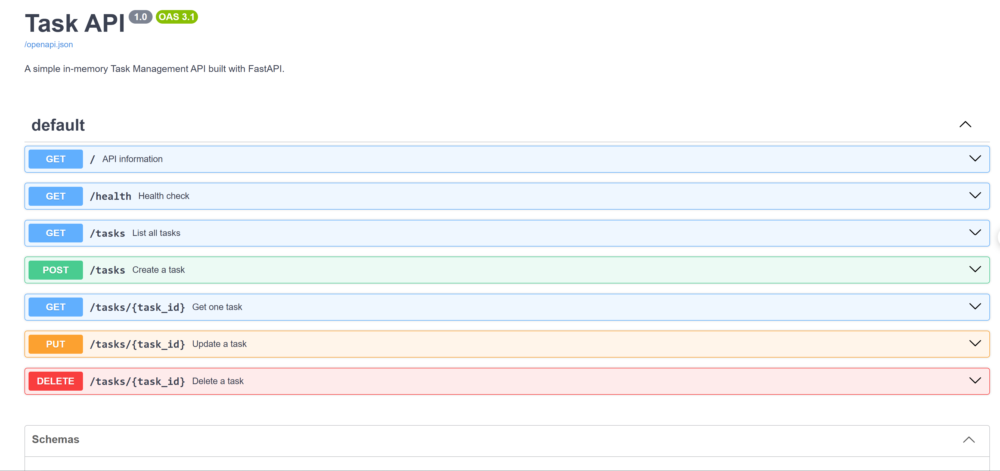

# Task Management API

A RESTful API built with **Python** and **FastAPI** to create, retrieve, update, and delete tasks.

## Requirements

- Python 3.10+
- pip

## Installation and Setup

### 1. Clone the repository

```bash
git clone https://github.com/engy-salem/First_CRUD_API.git
cd First_CRUD_API
```

### 2. Create a virtual environment

```bash
python -m venv .venv
```

### 3. Activate the virtual environment

**Windows PowerShell:**

```powershell
.venv\Scripts\Activate.ps1
```

**macOS / Linux:**

```bash
source .venv/bin/activate
```

### 4. Install dependencies

```bash
python -m pip install -r requirements.txt
```

### 5. Run the API

```bash
uvicorn main:app --reload
```

The API is available at:

http://127.0.0.1:8000

## Interactive API Documentation

FastAPI automatically generates interactive API documentation using Swagger UI.

The Swagger documentation is available at:

http://127.0.0.1:8000/docs

Swagger UI provides an interactive interface to explore and test all API endpoints using the **Try it out** feature.

### Swagger UI Screenshot



## API Endpoints

| Method | Endpoint | Description | Success Status |
|---|---|---|---:|
| GET | `/` | API information | 200 |
| GET | `/health` | Health check | 200 |
| GET | `/tasks` | List all tasks | 200 |
| GET | `/tasks/{task_id}` | Get one task by ID | 200 |
| POST | `/tasks` | Create a new task | 201 |
| PUT | `/tasks/{task_id}` | Update an existing task | 200 |
| DELETE | `/tasks/{task_id}` | Delete a task | 204 |

## Error Responses

The API handles the following errors:

- **400 Bad Request:** Returned when the request body is invalid or the task title is missing or empty.
- **404 Not Found:** Returned when the requested task ID does not exist.

Both error responses contain an `error` message.

## Example Requests

The following examples show how to interact with the API using curl.

### Windows PowerShell

**Important:** Use `curl.exe` instead of `curl` in Windows PowerShell.

#### 1. List all tasks

```powershell
curl.exe -i http://localhost:8000/tasks
```

#### 2. Get one task

```powershell
curl.exe -i http://localhost:8000/tasks/1
```

#### 3. Create a new task

```powershell
$bodyFile = Join-Path $env:TEMP "task-api-body.json"
'{"title":"Buy milk"}' | Set-Content -NoNewline -Encoding ascii $bodyFile

curl.exe -i -X POST "http://localhost:8000/tasks" -H "Content-Type: application/json" --data-binary "@$bodyFile"
```

Expected status: `201 Created`

#### 4. Update an existing task

```powershell
$bodyFile = Join-Path $env:TEMP "task-api-body.json"
'{"title":"Study FastAPI","done":true}' | Set-Content -NoNewline -Encoding ascii $bodyFile

curl.exe -i -X PUT "http://localhost:8000/tasks/1" -H "Content-Type: application/json" --data-binary "@$bodyFile"
```

Expected status: `200 OK`

#### 5. Delete a task

```powershell
curl.exe -i -X DELETE "http://localhost:8000/tasks/1"
```

Expected status: `204 No Content`

#### 6. Test an invalid create request

```powershell
$bodyFile = Join-Path $env:TEMP "task-api-body.json"
'{}' | Set-Content -NoNewline -Encoding ascii $bodyFile

curl.exe -i -X POST "http://localhost:8000/tasks" -H "Content-Type: application/json" --data-binary "@$bodyFile"
```

Expected status: `400 Bad Request`

### macOS / Linux

The following commands can be executed directly in the terminal.

#### 1. List all tasks

```bash
curl -i http://localhost:8000/tasks
```

#### 2. Get one task

```bash
curl -i http://localhost:8000/tasks/1
```

#### 3. Create a new task

```bash
curl -i -X POST http://localhost:8000/tasks \
-H "Content-Type: application/json" \
-d '{"title":"Buy milk"}'
```

#### 4. Update an existing task

```bash
curl -i -X PUT http://localhost:8000/tasks/1 \
-H "Content-Type: application/json" \
-d '{"title":"Study FastAPI","done":true}'
```

#### 5. Delete a task

```bash
curl -i -X DELETE http://localhost:8000/tasks/1
```

#### 6. Test an invalid create request

```bash
curl -i -X POST http://localhost:8000/tasks \
-H "Content-Type: application/json" \
-d '{}'
```

Expected status: `400 Bad Request`

## API Testing Results

The API was tested using `curl.exe -i` in Windows PowerShell.

The following operations were tested:

| Operation | Endpoint | Expected Status | Result |
|---|---|---:|---|
| List all tasks | GET `/tasks` | 200 OK | Passed |
| Create a task | POST `/tasks` | 201 Created | Passed |
| Update a task | PUT `/tasks/4` | 200 OK | Passed |
| Delete a task | DELETE `/tasks/4` | 204 No Content | Passed |
| Get deleted task | GET `/tasks/4` | 404 Not Found | Passed |
| Create task without title | POST `/tasks` | 400 Bad Request | Passed |

### Successful GET Request

```text
HTTP/1.1 200 OK
content-type: application/json

[{"id":1,"title":"Study Python","done":false},{"id":2,"title":"Finish Assignment","done":false},{"id":3,"title":"Learn FastAPI","done":true}]
```

### Successful POST Request

```text
HTTP/1.1 201 Created
content-type: application/json

{"id":4,"title":"Buy milk","done":false}
```

### Successful PUT Request

```text
HTTP/1.1 200 OK
content-type: application/json

{"id":4,"title":"Buy milk","done":true}
```

### Successful DELETE Request

```text
HTTP/1.1 204 No Content
```

### Task Not Found

```text
HTTP/1.1 404 Not Found
content-type: application/json

{"error":"Task 4 not found"}
```

### Validation Error

```text
HTTP/1.1 400 Bad Request
content-type: application/json

{"error":"Title is required and cannot be empty"}
```

## Storage

Tasks are stored in a Python list in memory.

- No database is used.
- No file storage is used.
- The task list resets to the three example tasks whenever the server restarts.

## Project Structure

```text
First_CRUD_API/
│
├── main.py
├── requirements.txt
├── README.md
├── .gitignore
└── docs/
    └── swagger.png
```
